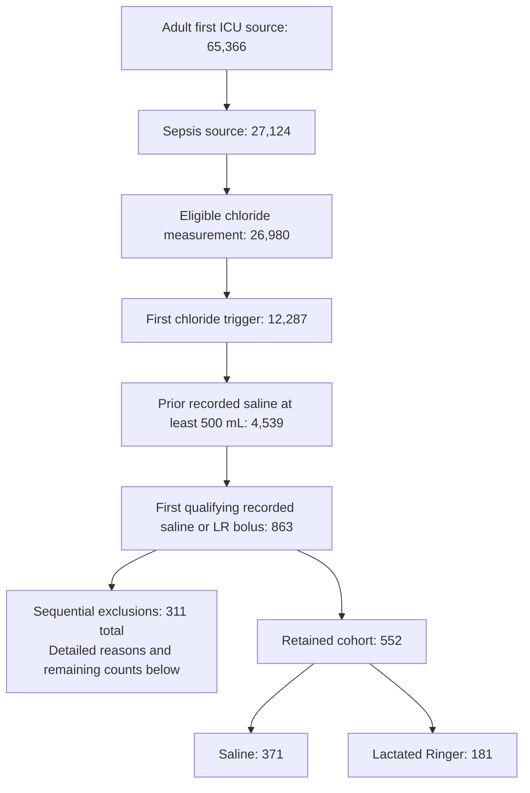

# Participant selection flow

This flow documents the retained **552-person cohort**, not the historical 706-person analysis. Counts reproduce the retained aggregate flow file; no new cohort extraction or estimation was performed for this display.

## Sequential exclusions from 863 candidates

Each patient is counted under the first failed rule. Exclusion counts are mutually exclusive; they must not be added to the upstream screening counts.

| Rule | Excluded at this step | Remaining |
|---|---:|---:|
| Candidate recorded bolus recipients | — | 863 |
| Simultaneous different fluids | 1 | 862 |
| Incompatible alive/ICU/hospital chronology | 7 | 855 |
| Invalid recorded administration interval | 0 | 855 |
| Unavailable baseline creatinine/comparator | 165 | 690 |
| Preceding creatinine stage 3 | 50 | 640 |
| Preceding urine-output stage 3 | 49 | 591 |
| Preceding treatment-supported KRT | 34 | 557 |
| Preceding documented ESRD/dialysis dependence | 5 | 552 |

**Arithmetic:** 863 − (1 + 7 + 0 + 165 + 50 + 49 + 34 + 5) = 552 = 371 saline + 181 LR.

## Relation to the six-hour landmark

The six-hour landmark was added for the October 2026 revision. It retains patients alive, still in the index ICU and free of the kidney composite at six hours. It is a separate sensitivity population, not a replacement for the 552-person cohort.

| Six-hour state | Saline | LR | Total |
|---|---:|---:|---:|
| Original cohort | 371 | 181 | 552 |
| Kidney composite by six hours | 9 | 0 | 9 |
| Other competing event by six hours | 10 | 6 | 16 |
| Retained at the landmark | 352 | 175 | 527 |

The landmark excludes 25 patients, not just the nine early kidney events. Follow-up ends at the original day 7. Conditioning on post-treatment status changes the target population and can introduce selection bias.

## Definitions and sources

The chloride trigger uses the later of specimen collection and result storage, as an availability proxy. The index exposure is the first qualifying recorded saline/LR bolus after the trigger and within four hours. No minimum final bolus volume or completed-status requirement is imposed. The prior-saline requirement concerns the preceding 24-hour window. Full timing, category and exclusion definitions are in the retained extraction implementation and protocol. Recorded timestamps do not establish when clinicians read results or made treatment decisions.

- [Original aggregate screening counts](../03结果/21_FULL_ICU_CAUSAL_PROGRAM_20260907/N09/rebuilt_analysis/flow.csv)
- [Frozen protocol](../03结果/21_FULL_ICU_CAUSAL_PROGRAM_20260907/N09/rebuilt_analysis/protocol.json)
- [Extraction SQL](../03结果/21_FULL_ICU_CAUSAL_PROGRAM_20260907/N09/rebuilt_analysis/extraction.sql)
- [Landmark selection counts](../03结果/21_FULL_ICU_CAUSAL_PROGRAM_20260907/N09/critical_care_revision/results/landmark_flow.csv)
- [Landmark estimates](../03结果/21_FULL_ICU_CAUSAL_PROGRAM_20260907/N09/critical_care_revision/results/landmark_estimates.csv)
- [Revision plan dated 24 October 2026](../03结果/21_FULL_ICU_CAUSAL_PROGRAM_20260907/N09/critical_care_revision/results/revision_plan.json)
